 

My day job is in emergency medical services (Rettungsdienst), full-time. Code is what I do with
the rest of my time, and I've been at it since 2009.

Most of it goes into [SLNE-Development](https://github.com/SLNE-Development): the Minecraft
network I help run. That means Paper and Velocity plugins in Kotlin and Java, the services
behind them, and the web apps around it all, from admin panels to roadmaps. Now and then I
build something in Unity or Blender just for fun.

 

### Where my time goes

&nbsp;&nbsp;

Built from every commit I've authored, old e-mail addresses included, and refreshed every
night. Hours are estimated from commit times like [git-hours](https://github.com/kimmobrunfeldt/git-hours)
does it. Anything before 2019 never made it into git, so 2009 to 2018 is missing.
[How it's counted](./stats)

 

### What I work with

**Languages** 

**Frameworks and libraries** 

**Infrastructure** 

**Tools** 

 

### AI

I code with **Claude Code**. I plan, review and steer, and Claude does a lot of the typing.
