  

  
  
  
  

 

## About me

- **Minecraft server software** at [SLNE-Development](https://github.com/SLNE-Development): Paper & Velocity plugins and the services behind them, written in Kotlin and Java
- **Full-stack web**: TypeScript with React, Next.js, tRPC, Drizzle and Tailwind, and PHP with Laravel
- **Side quests**: game dev with Unity & Blender, shaders, Rust and Go tooling
- Writing code since **2009**, long before Git remembered any of it

 

## What I actually write

  
  &nbsp;
  

  Generated from every commit I authored (including old e-mails), not from repo sizes. Hours are estimated from commit timestamps, the way <a href="https://github.com/kimmobrunfeldt/git-hours">git-hours</a> does it. <a href="./stats">How it works</a>

 

## Tech stack

**Languages**

  

**Frameworks & libraries**

  

**Infrastructure**

  

**Tools**

  

 

## AI in my workflow

  
  

Most of my day-to-day coding runs through **Claude Code**: I plan, review and steer, and Claude does a lot of the typing.
The commits-per-year chart shows it pretty clearly.

 

  Cards are rebuilt every night by a <a href="./.github/workflows/language-stats.yml">GitHub Action</a> in this repo.

